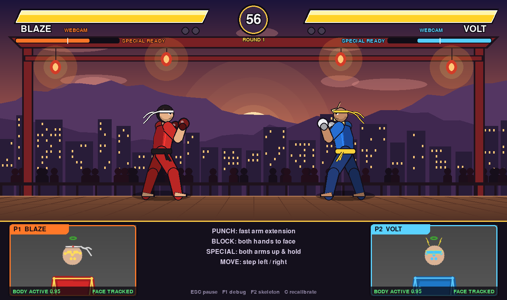
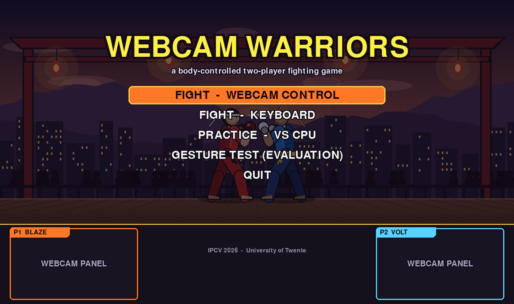
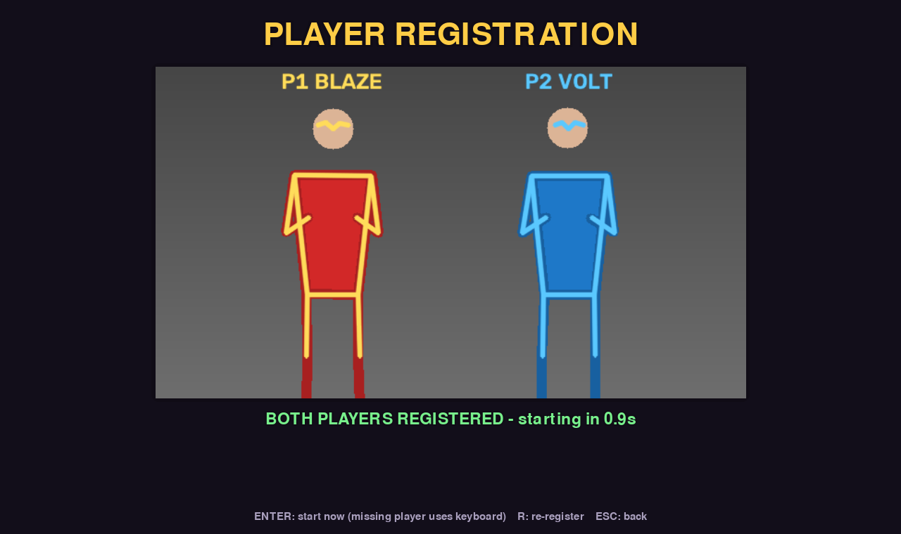

# Webcam Warriors — IPCV 2026 webcam-controlled fighting game

A real-time, two-player, Street-Fighter-style 2D fighting game controlled
entirely by body movement in front of a **single webcam**. Built for the
University of Twente IPCV 2026 course project (Webcam-Based Interactive Game
Design). All five compulsory tasks run together in one application.



| Menu | Player registration |
|---|---|
|  |  |

> The screenshots were produced with the built-in **synthetic test scenario**
> (`--vision synthetic`), not a real webcam — see [Testing status](#testing-status).

---

## 1. Installation

Requirements: Python **3.10 – 3.13** (3.11 or 3.12 recommended), a webcam,
and ~200 MB of disk space. No GPU needed.

### macOS (Apple Silicon)

```bash
cd IPCV_Fighting_Game
python3 -m venv .venv
source .venv/bin/activate
pip install --upgrade pip
pip install -r requirements.txt
python scripts/download_models.py          # MediaPipe pose + face models (~35 MB)
python -m pytest -q                        # optional: run the unit tests
python main.py
```

The first time the game opens the camera, macOS asks for camera permission
**for the app you launched it from** (Terminal, iTerm, VS Code, PyCharm).
If you clicked "Don't allow", enable it in *System Settings → Privacy &
Security → Camera* and restart that app.

If `download_models.py` fails with an SSL certificate error (python.org
installer), run `/Applications/Python 3.x/Install Certificates.command` or
`pip install certifi`, then retry.

### Windows 10/11

```powershell
cd IPCV_Fighting_Game
py -3.12 -m venv .venv
.venv\Scripts\activate
python -m pip install --upgrade pip
pip install -r requirements.txt
python scripts\download_models.py
python -m pytest -q
python main.py
```

If PowerShell blocks `activate`, run once:
`Set-ExecutionPolicy -Scope CurrentUser RemoteSigned`.
If the camera does not open, close other apps using it (Teams, Zoom) or try
`python main.py --camera 1`. The capture backend is chosen automatically
(DirectShow on Windows, AVFoundation on macOS) and can be forced in
`config.json` (`"camera": {"backend": "msmf"}`).

### Verify two-person detection on your machine

```bash
python scripts/verify_multipose.py             # 20 s live check, press Q to stop
python scripts/verify_multipose.py --image photo_of_two_people.jpg
```

It prints how often 0/1/2 people and faces were detected and the measured
inference time per model. Run this before your first two-player session.

---

## 2. Running and playing

```bash
python main.py                     # menu
python main.py --log               # + write evaluation CSV logs to logs/
python main.py --camera 1 --width 1280 --height 720
python main.py --start keyboard    # skip the menu
python main.py --vision synthetic  # no webcam: scripted synthetic players (demo/test)
python main.py --fullscreen --mute --debug
```

Menu modes: **Webcam fight**, **Keyboard fight**, **Practice vs CPU**,
**Gesture test** (evaluation protocol), **Quit**.

### Setting up the play area

* Camera at chest height, both players **side by side, facing the camera**,
  about **2–3 m** away so heads, shoulders, arms and hips are in view.
* Player 1 stands **left**, Player 2 **right** during registration only.
  After that you may move, cross and swap sides freely.
* Different-coloured tops help identity tracking during crossings.
* Even, frontal lighting; avoid a bright window behind the players.

### Body controls (webcam mode)

| Action | Movement | Notes |
|---|---|---|
| Left punch | fast forward extension of the **left** arm | towards the camera or sideways; must pull the arm back before the next punch |
| Right punch | fast forward extension of the **right** arm | same |
| Block | **both hands near the face** | held as long as the guard is held |
| Special (energy ball) | **both arms raised above the head**, hold ~0.35 s | needs half an energy bar; lower arms to re-arm |
| Move | **step left / right** from your registered position | dead zone ignores swaying |

The keyboard always works in parallel (useful for testing or a missing player):

| | Move | Block | Left punch | Right punch | Special |
|---|---|---|---|---|---|
| P1 | A / D | S | F | G | R |
| P2 | ← / → | ↓ | K | L | I |

Other keys: **Esc** pause/back, **Enter** confirm/rematch, **F1** debug
overlay (FPS, latency, tracking signals, full camera view with both
skeletons), **F2** toggle skeletons in the webcam panels, **C** recalibrate
neutral positions, **R** (registration screen) re-register players.
Evaluation annotation keys: see section 6.

---

## 3. Architecture

```
            ┌────────────────┐ newest frame ┌──────────────────────────────────────────┐
 webcam ──▶ │ camera thread  │ ───────────▶ │ vision thread (vision/pipeline.py)       │
            │ vision/camera  │ (old frames  │  pose (MediaPipe, num_poses=2)           │
            └────────────────┘  dropped)    │  face (MediaPipe, num_faces=2)           │
                                            │  identity tracking  → P1 / P2            │
                                            │  smoothing, gestures, face geometry      │
                                            └───────┬──────────────────────┬───────────┘
                                         snapshot   │                      │ gesture events
                                       (immutable)  ▼                      ▼ (thread-safe queue)
            ┌─────────────────────────────────────────────────────────────────────────┐
            │ main thread (application.py): 60 Hz render loop, fixed-step game logic, │
            │ keyboard + CPU + webcam input merge, effects, HUD, webcam panels + AR   │
            └─────────────────────────────────────────────────────────────────────────┘
```

* Inference never blocks rendering: the game reads the latest snapshot.
* Game logic (`game/`) is pure Python with no pygame/OpenCV dependency, so it
  is fully unit-tested and identical for keyboard and webcam input.

| Task | Main implementation |
|---|---|
| 1 Face tracking & AR | `vision/face_tracking.py` (geometry, smoothing, dropout handling), `rendering/face_effects.py` (AR effects + status effect) |
| 2 Body pose & motion | `vision/pose_tracking.py` (multi-person backend, per-player state), `vision/smoothing.py` (One Euro filter, missing landmarks) |
| 3 Multiplayer identity | `vision/player_tracking.py` |
| 4 Interaction & control | `vision/gesture_recognition.py`, `game/controls.py`, `game/fighter.py`, `game/combat.py`, `game/collision.py` |
| 5 Integration & scene | `vision/pipeline.py`, `application.py`, `rendering/*`, `evaluation/performance.py` |
| Evaluation | `evaluation/*.py`, `scripts/analyze_session.py`, `scripts/verify_multipose.py` |

```
IPCV_Fighting_Game/
  main.py  application.py  config.py  requirements.txt  config.example.json
  vision/     camera, pose_tracking, face_tracking, player_tracking,
              gesture_recognition, smoothing, pipeline, synthetic
  game/       fighter, combat, collision, controls, game_state, ai
  rendering/  arena, characters, animations, effects, face_effects, interface, sound
  evaluation/ session, performance, tracking_metrics, gesture_metrics
  scripts/    download_models, verify_multipose, analyze_session
  tests/      test_game_logic.py, test_vision_pipeline.py
  assets/     models/ (downloaded), characters/ backgrounds/ sounds/ (empty: all procedural)
```

All graphics and sounds are generated procedurally in code — no third-party
art or audio assets are used.

---

## 4. Computer-vision pipeline

### Task 2 — multi-person pose (why MediaPipe *Tasks*)
The legacy `mp.solutions.pose` is single-person only (and is removed from
current MediaPipe releases). The project uses the **Tasks `PoseLandmarker`
with `num_poses=2`**, which runs a person detector and then a landmark model
per detected person, returning up to two 33-landmark skeletons per frame with
visibility scores and metric "world" coordinates. Verify on your hardware
with `scripts/verify_multipose.py`.

Per player (`PlayerPose`):
* **Confidence**: per-landmark visibility; a landmark below 0.5 is *missing*.
* **Temporal filtering**: One Euro filter per landmark (adaptive low-pass:
  strong smoothing when still, little lag when fast).
* **Missing landmarks**: held for 0.25 s (marked *held*), then invalid;
  filters restart on reappearance (no sliding from stale positions); gestures
  never fire on incomplete data. Recoveries are counted.
* **Velocity**: from the filter's derivative estimate, using camera timestamps.
* **Scale normalisation**: everything is measured in *shoulder widths* (median
  over 15 frames), so thresholds work at any distance from the camera.

### Task 3 — identity tracking
* Registration once: left person → P1, right person → P2 (the *only* use of
  left/right ordering).
* Every frame: optimal assignment (brute-force Hungarian on the 2×N problem)
  with cost = motion (distance to the **constant-velocity prediction**) +
  appearance (**Bhattacharyya distance of HSV torso histograms**) + size.
* **Crossing**: when players overlap, appearance weight is boosted and the
  appearance models are frozen (no contamination).
* **Occlusion**: unmatched track coasts on its prediction (LOST, 1.2 s) and is
  re-acquired by motion + appearance.
* **Disappearance / re-entry**: then ABSENT, re-identified by appearance only,
  or by elimination when exactly one player is missing.
* **Face ↔ body**: each face is assigned to the body whose pose-nose is
  nearest (gated, optimal assignment), only bodies matched in the current
  frame may claim a face. Effects, controls, health and score are keyed by the
  track id, never by detector order (which the synthetic test shuffles every frame).

### Task 1 — faces and AR
* FaceLandmarker (`num_faces=2`, 478-point mesh).
* **Position**: eye midpoint + forehead anchor; **scale**: inter-ocular
  distance corrected for yaw (`/cos yaw`), so effects keep their size when the
  head turns; **orientation**: roll from the eye line, yaw from nose–cheek
  asymmetry, pitch ratio from nose between forehead and chin. These are 2D
  geometric approximations, not full 6-DoF head pose.
* One Euro smoothing of position/scale, wrap-safe angle filtering.
* **Detection failures**: < 0.5 s → constant-velocity prediction with fading
  (PREDICTED); longer → coarse head estimate from the body-pose eyes/ears
  (POSE FALLBACK); otherwise LOST.
* **Effects** (`rendering/face_effects.py`), drawn in a face-local frame so
  they translate, scale, rotate and foreshorten with the head:
  P1 headband with trailing tails, P2 visor with lightning horns.
  **Status effect**: health ring gauge over the head (green → red), blue
  shield while blocking, red flash when hit, sparks while charging the
  special, dizzy stars on KO, crown for the round winner.
* Shown in the two webcam panels, which crop and follow each player's identity.

### Task 4 — gestures → actions
All thresholds are in shoulder widths (sw) and configurable (`config.py`).
* **Punch** (per arm state machine `ARMED → fire → EXTENDED → retract → ARMED`):
  fires when the arm reach rises faster than 2.5 sw/s and exceeds 1.35 sw,
  with the wrist at chest/head height. Holding the arm out never re-fires;
  the arm must come back below 1.05 sw, plus a 0.3 s cooldown. Slow reaching
  is consumed without firing.
  **Monocular depth**: a punch towards the camera barely changes the 2D image,
  so reach is the larger of (a) 2D reach and (b) reach from MediaPipe's
  *estimated* metric world landmarks. (b) is an approximation from a single
  camera — not a measured 3D trajectory.
* **Block**: both wrists within 0.85 sw of the nose for 80 ms (confirmation),
  released above 1.05 sw (hysteresis).
* **Special**: both wrists 0.45 sw above the nose held 0.35 s; re-arms only
  after both arms drop below the shoulders; 2.5 s cooldown; costs energy.
* **Move**: shoulder-midpoint offset from the registered neutral position;
  dead zone 0.3 sw, full speed at 1.1 sw, EMA smoothed.
* Both players are processed independently in the same frame, so
  simultaneous actions are supported (and simultaneous punches trade hits).
* Game side: hit/hurt boxes, startup/active/recovery frames, 150 ms input
  buffer, block damage reduction (85 %), counter hits, combo scaling,
  projectiles with clashes, KO, time-out, best of 3 rounds.

### Task 5 — integration
Threaded capture → inference → snapshot; fixed-step 60 Hz logic; hit-stop,
screen shake, particles (capped), animated arena that reacts to big hits,
round intro/KO/time/victory transitions, live FPS/latency overlay (F1) and
graceful degradation: missing models or camera → readable error and keyboard
play; lost player → "TRACKING LOST" in their panel, keyboard still works.

---

## 5. Testing status

What has been run (on a Linux machine **without a webcam**, where the
MediaPipe model download was blocked by the network):

* `pytest`: 25 tests — game logic (hits, blocking, buffering, trades,
  specials, projectiles/clashes, KO, time-out, restart, counter hits) and
  vision logic (One Euro filter, missing-landmark hold/recovery, punch fires
  once while the arm stays extended, slow reach does not fire, identity kept
  through a full crossing, occlusion recovery and re-entry, faces never
  switch players, expected gesture counts, trial scoring).
* Headless runs of every scene (menu, keyboard, CPU, webcam with the synthetic
  scenario, gesture test) and a 3-minute synthetic stability run with logging.
* MediaPipe Tasks API calls were checked against installed mediapipe 0.10.32
  and 1.1.1 (classes, options, result fields).

**Not yet verified — needs your hardware:** real MediaPipe inference with the
downloaded models, real two-person detection quality, the camera on macOS /
Windows, gesture thresholds on real people, audio output, and actual FPS on
Apple Silicon. The synthetic scenario only proves the *logic*; its "metrics"
are not results. Use the checklist below and the evaluation tools.

### Live test checklist (please do this first)
1. `python scripts/verify_multipose.py` with two people → note the % of frames with 2 poses and inference times.
2. `python main.py --debug --log` → Webcam fight. Registration should show P1/P2 labels.
3. One player: throw single punches with each arm; hold an arm extended (must hit **once**); guard the face (BLOCK light); raise both arms (special); step left/right.
4. Two players: punch at the same time; walk past each other (crossing) and check the labels/effects in the panels stay with the right person; one player leaves the frame and returns.
5. Turn your head, lean, move closer/further: AR effects should stay aligned.
6. If punches are missed or trigger too easily, read `reach`/`rate` in the F1 overlay and adjust `punch_extend_ratio` / `punch_min_speed` in `config.json`.
7. Play several full matches (≥ 10 min) with `--log`, then `python scripts/analyze_session.py`.

---

## 6. Evaluation tools

Run with `--log`. Each run creates `logs/session_<timestamp>/` with
`performance.csv`, `vision_frames.csv`, `tracker_events.csv`, `gestures.csv`,
`annotations.csv`, `gesture_trials.csv` and `meta.json` (config + platform).
Then:

```bash
python scripts/analyze_session.py            # newest session → summary.md / summary.json
```

**Operator annotation keys** (ground truth, recorded with timestamps):

| Key | Meaning |
|---|---|
| F5 | start / stop a *stationary* window (players hold still) — for stationary jitter |
| F6 | you SAW an identity switch (labels/effects on the wrong person) |
| F7 | a crossing finished with identities correct |
| F8 | a crossing finished with identities wrong |

**Gesture test mode** prompts "P1: RIGHT PUNCH", "P2: BLOCK", simultaneous
punches and idle periods (5 repetitions, ~50 trials). The prompt is the label,
giving precision, recall, missed actions, idle false positives per minute and
simultaneous-action success without video annotation.

| Metric | How it is obtained | Ground truth |
|---|---|---|
| Face detection rate | tracked frames / active frames | automatic |
| Stationary jitter (face, landmarks) | RMS deviation in F5 windows, raw vs filtered, in face scales / shoulder widths | F5 windows |
| Dynamic jitter | RMS 2nd difference while moving, raw vs filtered | automatic |
| Face-effect alignment | smoothed anchor vs measured forehead landmark (face scales) | automatic |
| Keypoint reliability | % frames each key joint is observed | automatic |
| Missing-landmark recovery | recoveries, % frames with held joints | automatic |
| Processing latency | per stage (pose, face, tracking), capture→result | automatic |
| Identity switches, identity accuracy | F6 count per minute / per crossing | **MANUAL** |
| Crossing success rate | F7 / (F7 + F8) | **MANUAL** |
| Occlusion recovery | LOST→ACTIVE gaps | automatic |
| Re-entry recovery time | person visible again → identity restored | automatic |
| Gesture precision / recall / missed | gesture test trials | prompted protocol |
| False positive rate | detections in idle trials per minute | prompted protocol |
| Recognition latency | motion onset → confirmed gesture | automatic |
| Command latency | confirming frame capture → game tick applying it | automatic |
| Simultaneous action success | both players detected in simultaneous trials | prompted protocol |
| FPS, 1 % low FPS, end-to-end latency, CPU, RAM, long-run stability | `performance.csv` (first vs last third) | automatic |

End-to-end latency is measured from the moment `read()` returns a camera frame
to the first display flip showing its result; camera exposure and driver
latency before that are not measurable in software and are excluded.

---

## 7. Known limitations

* **Depth**: forward punches rely on MediaPipe's estimated world coordinates
  from one camera; very small or slow punches straight at the camera may be
  missed. Sideways punches are detected from 2D and are more reliable.
* **Multi-person pose** quality depends on both people being fully visible;
  strong overlap during crossings often hides one person for a moment — the
  tracker coasts through it, but very long full occlusions end in re-entry
  logic.
* **Appearance re-identification** uses clothing colour; two players in
  identical colours make crossings rely on motion prediction alone.
* **Face orientation** is approximated geometrically (roll exact in 2D,
  yaw/pitch approximate); extreme head turns (> ~60°) lose the face mesh, then
  the pose-based fallback places effects with lower precision.
* Webcam panels crop the shared camera image, so when players stand very close
  both appear in each panel (effects are still drawn only on the correct face).
* Gesture thresholds are defaults; tune them in `config.json` for your room.
* Audio is synthesised and simple; if no audio device is available the game
  runs silently.

---

## 8. Configuration

All parameters live in `config.py` (camera index/resolution/backend,
inference size, model files, detection confidences, filter parameters,
tracking weights and timeouts, gesture thresholds, game balance). Override any
of them without editing code by copying `config.example.json` to
`config.json`, or pass `--config my.json`. Paths are relative to the project.

To trade accuracy for speed: `pose_landmarker_lite.task`
(`python scripts/download_models.py --pose lite`), lower `inference_width`,
or `"face": {"run_every_n_frames": 2}`.

---

## 9. AI usage declaration (template — fill in and keep honest)

> **Generative AI use in this project**
>
> Tool(s) and version: *e.g. Claude (Anthropic), Opus 5.5, used via claude.ai, dates: …*
>
> What the AI produced: *e.g. initial implementation of the project skeleton,
> game logic, rendering, vision pipeline, evaluation tooling, tests and this
> README, from our written specification.*
>
> What we did ourselves: *e.g. requirements/specification, design decisions
> A, B, C, live testing with the webcam, threshold tuning, data collection,
> all reported measurements, analysis and conclusions, changes to files X, Y.*
>
> How we verified the output: *e.g. read and understood every module, ran the
> unit tests, ran N live sessions with M participants, compared metrics before
> and after changes, fixed the following issues: …*
>
> Responsibility: we have reviewed the code and are able to explain every part
> of it; all evaluation results in the report come from our own measurements.
>
> Names / student numbers / date: …

---

## 10. Troubleshooting

| Problem | Fix |
|---|---|
| "Pose model not found" | `python scripts/download_models.py` |
| "Could not open camera" | camera permission (macOS), close other camera apps, try `--camera 1` |
| Only one skeleton | both people fully in frame, more light, step back; check with `verify_multipose.py` |
| Low FPS | lite pose model, `inference_width` 480, face every 2 frames; see F1 overlay |
| Punches trigger while moving | raise `punch_min_speed` or `punch_extend_ratio` |
| Punches missed | lower them; punch with the arm at shoulder height |
| Players swapped after registration | press R in the registration screen; wear different colours |
